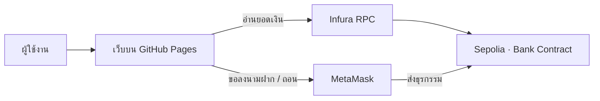

<div align="center">

# Bank DApp
### CSI301 · Assignment 7

ฝาก ถอน และตรวจสอบยอดเงินบน **Ethereum Sepolia**  
พัฒนาด้วย **Web3.js · Infura · MetaMask**

**[🌐 เปิดใช้งานเว็บไซต์](https://aomsinspu.github.io/csi301-assignment7-infura/)** · **[📄 ดู Smart Contract](https://sepolia.etherscan.io/address/0x7AE51eb74CC9E7DcB20A0c5F0E878fE7f0B11340#code)**

</div>

---

## เกี่ยวกับโปรเจกต์

เว็บ DApp ระบบธนาคารสำหรับทดลองฝากและถอน Sepolia ETH ผ่าน Smart Contract โดยใช้ **Infura อ่านข้อมูลบนบล็อกเชน** และ **MetaMask เชื่อมบัญชีและยืนยันธุรกรรม** หน้าเว็บเปิดใช้งานได้ผ่าน GitHub Pages โดยไม่ต้องรันเซิร์ฟเวอร์ Node.js

## ความสามารถ

| ฟังก์ชัน | การทำงาน |
| --- | --- |
| Connect | เชื่อมบัญชี MetaMask และตรวจสอบเครือข่าย Sepolia |
| Deposit | ฝาก Sepolia ETH เข้าสัญญาและบันทึกยอดตามบัญชี |
| Withdraw | ถอนเงินได้ไม่เกินยอดฝากของบัญชีนั้น |
| Check Balance | อ่านยอดเงินฝากผ่าน Infura |
| Transaction Status | แสดงสถานะและลิงก์ตรวจสอบรายการบน Etherscan |
| Disconnect | ล้างการเชื่อมต่อในหน้าเว็บ |

## เริ่มใช้งาน

1. เปิด **[Bank DApp บน GitHub Pages](https://aomsinspu.github.io/csi301-assignment7-infura/)** ในเบราว์เซอร์ที่ติดตั้ง MetaMask
2. กรอก **Infura API Key** หรือ **Sepolia HTTPS URL** ลงในช่องเชื่อมต่อ
3. กด **เชื่อมต่อ MetaMask** แล้วอนุญาตบัญชีที่ต้องการ หากเครือข่ายไม่ตรง เว็บจะขอเปลี่ยนเป็น Sepolia
4. กรอกจำนวน ETH แล้วกด **ฝากเงิน** หรือ **ถอนเงิน** และยืนยันใน MetaMask
5. รอผลธุรกรรม แล้วตรวจยอดล่าสุดหรือเปิดลิงก์ Etherscan

ตัวอย่างรูปแบบ URL:

```text
https://sepolia.infura.io/v3/YOUR_API_KEY
```

> ใช้ Sepolia ETH สำหรับเงินฝากและค่าธรรมเนียม ไม่ต้องกรอก Private Key หรือ Secret Recovery Phrase บนหน้าเว็บ

## การเชื่อมต่อ



หน้าเว็บใช้ `Web3.providers.HttpProvider` สำหรับ Infura และใช้ Provider ของ MetaMask สำหรับส่งธุรกรรม จึงไม่ต้องนำ Private Key ออกจากกระเป๋า

## Smart Contract

| รายการ | ค่า |
| --- | --- |
| Network | Ethereum Sepolia |
| Chain ID | `11155111` |
| Deployed contract | `Assignment7` |
| Address | `0x7AE51eb74CC9E7DcB20A0c5F0E878fE7f0B11340` |
| Explorer | [เปิดบน Sepolia Etherscan](https://sepolia.etherscan.io/address/0x7AE51eb74CC9E7DcB20A0c5F0E878fE7f0B11340#code) |

- `deposit()` — ฝากเงินด้วยค่า `msg.value`
- `withdraw(uint256 amount)` — ถอนเงินตามจำนวนที่ระบุเป็น wei
- `checkBlance()` — อ่านยอดฝากของผู้เรียก หน่วยเป็น wei โดยคงชื่อฟังก์ชันตาม ABI

ช่องจำนวนเงินบนเว็บรับหน่วย **ETH** และแปลงเป็น **wei** ก่อนเรียกสัญญา ยอดที่แสดงคือเงินฝากใน Contract ไม่ใช่ยอดทั้งหมดในกระเป๋า

## โครงสร้างไฟล์

```text
├── index.html              # หน้าเว็บ
├── styles.css              # รูปแบบและการจัดวาง รองรับมือถือ
├── app.js                  # เชื่อม MetaMask / Infura และเรียก Contract
├── vendor/                 # Web3.js และใบอนุญาต
├── contracts/Bank.sol      # ซอร์ส Contract สำหรับ Compile / ทดสอบในเครื่อง
├── contract-abi.json       # ABI ของฟังก์ชันธนาคาร
├── test/                   # การทดสอบ Contract และ API บนเครือข่ายจำลอง
├── compile.cjs             # เครื่องมือ Compile Solidity
└── deploy.cjs              # เครื่องมือ Deploy ผ่าน Infura แบบ Node.js
```

`server.cjs` และ `web3-connection.cjs` เป็นเครื่องมือของโหมด Node.js แยกจากหน้าเว็บบน GitHub Pages ซึ่งใช้ `app.js` เชื่อมต่อโดยตรง

## เปิดเว็บในเครื่อง

รันจากโฟลเดอร์โปรเจกต์:

```powershell
python -m http.server 8000 --bind 127.0.0.1
```

เปิด **http://127.0.0.1:8000** แล้วเชื่อมต่อเหมือนบน GitHub Pages

สำหรับ Compile และทดสอบ ต้องมี Node.js 22 ขึ้นไป:

```powershell
npm ci
npm run compile
npm test
```

การทดสอบใช้ Ganache ในเครื่อง ไม่ส่งธุรกรรม Sepolia จริง และไม่ครอบคลุมการกดยืนยันในส่วนขยาย MetaMask

---

## ผู้จัดทำ

**นายสรัล นิธิสมบัติสกุล**  
รหัสนักศึกษา **66057370** · รายวิชา **CSI301**
